# Mesurer la vitesse de la lumière avec deux ESP32

**Un instrument de physique à moins de 40 € :** deux cartes ESP32-S3 chronomètrent l'aller-retour d'une onde Wi-Fi, en nanosecondes, à plusieurs distances. La pente de la droite *temps / distance* donne **c, la vitesse de la lumière**. L'une des deux cartes est une console à écran tactile qui guide la mesure et affiche les courbes, les statistiques et le résultat en direct.

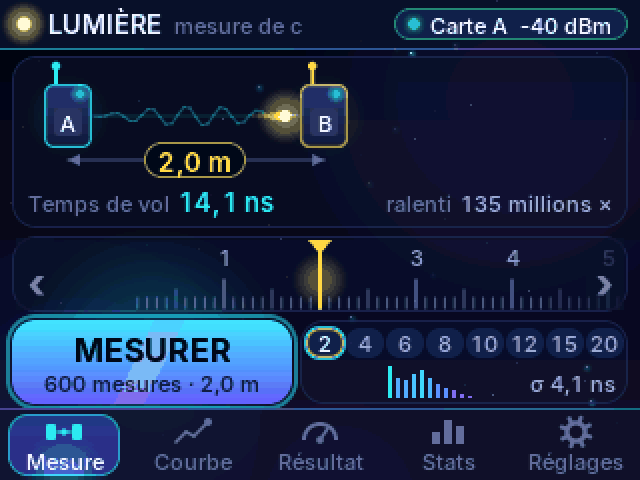

> 🎬 Vidéo de présentation commentée en français (5 min 36 s) : [**la vidéo (page Releases)**](https://github.com/Edunts5962/Esp32-vitesse-de-la-lumi-re-/releases/latest), avec ses sous-titres .srt (même page). Chapitres et description YouTube : [`video_youtube.md`](video_youtube.md).
> 🎓 Protocole pour étudiants : [`protocole_etudiants.md`](protocole_etudiants.md)

---

## Sommaire

1. [Le principe](#1-le-principe)
2. [Le matériel](#2-le-matériel)
3. [Les fichiers du projet](#3-les-fichiers-du-projet)
4. [Installation](#4-installation)
5. [Les écrans et tous les réglages](#5-les-écrans-et-tous-les-réglages)
6. [Ce qui se passe pendant une mesure](#6-ce-qui-se-passe-pendant-une-mesure)
7. [Mode opératoire](#7-mode-opératoire)
8. [Exploiter les données sur PC](#8-exploiter-les-données-sur-pc)
9. [Simulateur PC et vidéo](#9-simulateur-pc-et-vidéo)
10. [Dépannage](#10-dépannage)
11. [Licence et crédits](#11-licence-et-crédits)

---

## 1. Le principe

### La lumière, en chiffres

La lumière voyage à **c = 299 792 458 m/s**. Pour parcourir **1 mètre**, elle met **3,34 nanosecondes** (une nanoseconde est un milliardième de seconde). Les ondes Wi-Fi à 2,4 GHz sont des ondes électromagnétiques, comme la lumière visible : elles se propagent exactement à la même vitesse *c*.

### Un aller-retour d'onde radio

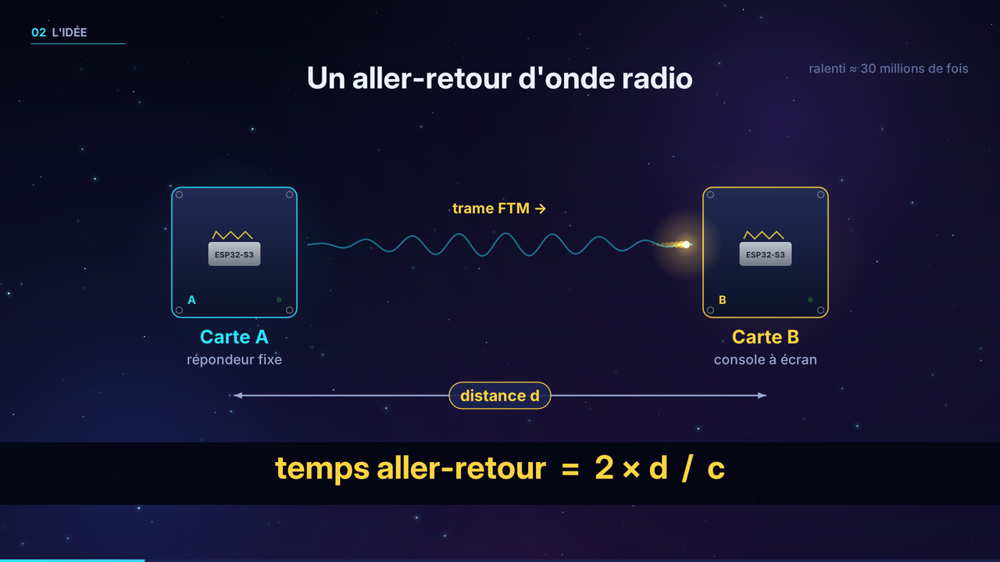

La **carte B** (la console à écran) échange des trames Wi-Fi avec la **carte A** (le répondeur fixe). Le temps d'aller-retour vaut :

```
t  =  2 × d / c
```

Par exemple, à 10 m, on obtient t = 66,7 ns.

### Le chronomètre caché du Wi-Fi : FTM

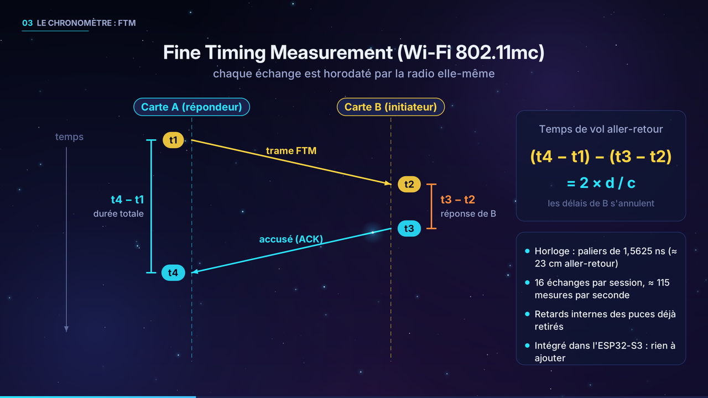

La norme Wi-Fi **IEEE 802.11mc** prévoit le *Fine Timing Measurement* (FTM). À l'origine, il sert à la géolocalisation en intérieur. Chaque trame est **horodatée par la radio elle-même** :

| Instant | Événement |
|---|---|
| **t1** | la carte A envoie une trame FTM |
| **t2** | la carte B la reçoit |
| **t3** | la carte B renvoie un accusé de réception (ACK) |
| **t4** | la carte A reçoit l'accusé |

```
temps de vol aller-retour  =  (t4 − t1) − (t3 − t2)
```

On retire `t3 − t2`, le temps de réponse de B : il ne reste que le trajet de l'onde. Les ESP32-S3 le font **en matériel** :
- avec une horloge de mesure à paliers de **1,5625 ns** (soit environ 23 cm d'aller-retour) ;
- en retirant déjà les retards internes des puces ;
- à raison de **16 échanges par session**, soit environ **115 mesures par seconde**.

> ⚠️ On n'utilise **jamais** la « distance estimée » que fournit le Wi-Fi : elle est calculée *avec* c, ce qui rendrait la mesure circulaire. On n'exploite que le temps brut.

### Une mesure seule est bruitée…

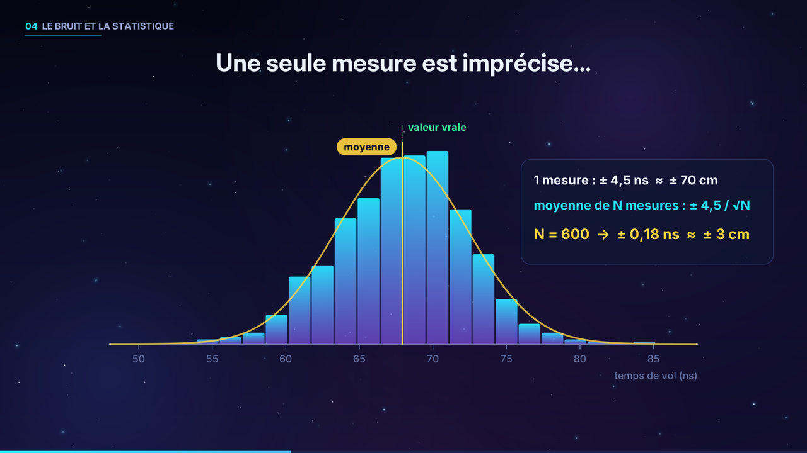

Une mesure isolée a une incertitude d'environ ± 4,5 ns, soit ± 70 cm. Pour la moyenne de N mesures, l'incertitude diminue comme **1/√N**. Avec 600 mesures par distance, on tombe à environ **± 0,2 ns**, soit quelques centimètres. Avant de faire la moyenne, le programme écarte les valeurs aberrantes (échos) grâce à un filtre robuste fondé sur la médiane.

### … mais une droite ne ment pas

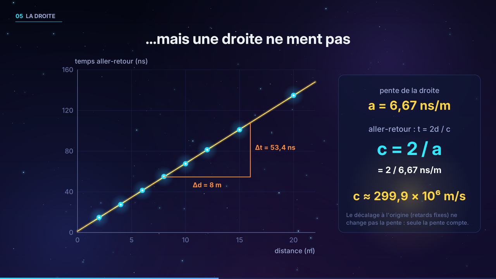

On mesure le temps moyen à 8 distances, de 2 à 20 m, et on trace la droite *temps = a × distance + b* :

```
pente  a = 2 / c        →        c = 2 / a
```

Le décalage à l'origine *b* regroupe les petits retards fixes qui restent. Il **ne change pas la pente** : seule la pente compte.

---

## 2. Le matériel

| Élément | Rôle | Remarque |
|---|---|---|
| **ES3C28P** (ESP32-S3, 8 Mo PSRAM, écran 2,8" ILI9341 tactile FT6336, microSD) | **Carte B** : console de mesure | C'est elle qu'on déplace |
| **ESP32-S3 DevKit** (ou toute carte ESP32-S3) | **Carte A** : répondeur FTM | Fixe, sur batterie |
| Mètre ruban de 20 m | Mesurer les distances | Mesurer d'antenne à antenne |
| 2 batteries USB | Alimenter les cartes | |
| Carte microSD (facultatif) | Enregistrer les mesures brutes | Fichier `lumiere.csv` |

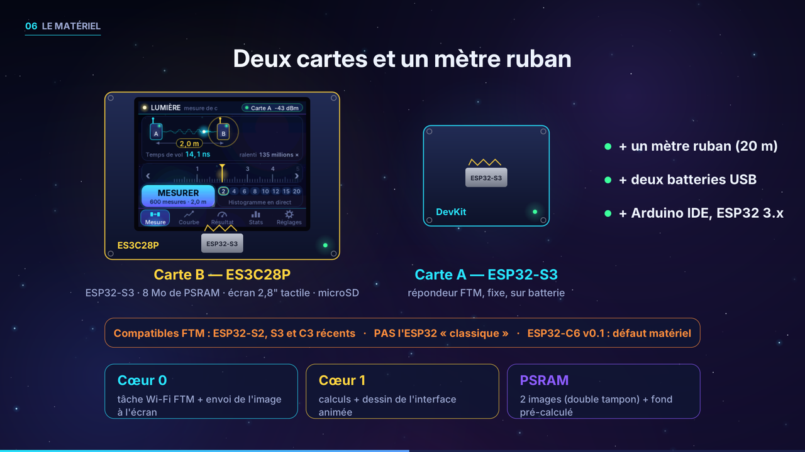

**Compatibilité FTM de la carte A**

| Puce | FTM | Note |
|---|---|---|
| ESP32-S3 | ✅ | **testé**, recommandé (même puce que la carte B) |
| ESP32-S2, ESP32-C3 (révision ≥ v0.3) | ✅ | prévus par Espressif |
| ESP32-C6 v0.1 | ❌ | testé : « pas de réponse » ; défaut matériel documenté par Espressif |
| ESP32 « classique » (sans suffixe) | ❌ | pas de FTM |

La révision de la puce s'affiche lors du téléversement : `Chip is ESP32-C6 (revision v0.1)`.

---

## 3. Les fichiers du projet

```
vitesse-lumiere-esp32/
├── firmware/
│   ├── lumiere_console/        ← carte B (ES3C28P)
│   │   ├── lumiere_console.ino    matériel : Wi-Fi FTM, écran, tactile, SD, mémoire NVS
│   │   ├── interface.cpp/.h       les 5 écrans animés, la règle tactile, les animations
│   │   ├── mesure.cpp/.h          échantillons, filtrage, points, droite, c, statistiques, simulation
│   │   ├── gfx.cpp/.h             moteur de dessin lissé (transparence, halos, texte)
│   │   ├── polices.cpp/.h         police Inter lissée avec accents (générée)
│   │   ├── ft6336_touch.cpp/.h    pilote de l'écran tactile
│   │   └── plateforme.h           ce que l'interface demande au matériel
│   └── lumiere_repondeur/      ← carte A
│       └── lumiere_repondeur.ino  point d'accès Wi-Fi « C_LUMIERE » avec répondeur FTM
├── outils/
│   ├── simulateur/sim_main.cpp    simulateur PC : même code d'interface, rendu en images
│   ├── simulateur/sim_tuto.cpp    scénario qui produit les captures et animations de ce dépôt
│   ├── video/faire_video.py       fabrique la vidéo de présentation (pycairo + ffmpeg)
│   ├── video/narration.py         voix off française synthétisée (Piper TTS)
│   ├── generer_polices.py         régénère polices.cpp à partir de la police Inter
│   └── mesure.py                  analyse sur PC du fichier lumiere.csv
├── images/ecrans/             captures de tous les écrans
├── images/principe/           schémas du principe
├── animations/                GIF animés
├── protocole_etudiants.md     TP clé en main
└── video_youtube.md           script, chapitres et description YouTube
(la vidéo MP4 et ses sous-titres sont dans la page Releases)
```

**Architecture de la carte B**

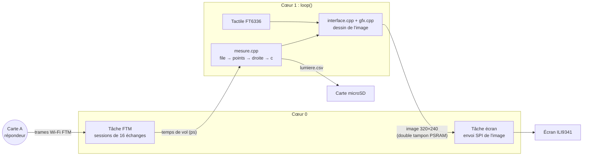

---

## 4. Installation

### Logiciels
- **Arduino IDE 2.x** avec le paquet de cartes **« esp32 by Espressif » version 3.x** (testé en 3.3.12)
- Bibliothèque **TFT_eSPI** configurée pour l'écran ILI9341 de l'ES3C28P (`User_Setup.h` : `ILI9341_DRIVER`, broches SPI de la carte, `USE_HSPI_PORT`, `SPI_FREQUENCY` à 40 MHz ou plus)

### Carte A : `firmware/lumiere_repondeur`
1. Carte : **ESP32S3 Dev Module** (ou celle qui correspond à ta carte A). Active « USB CDC On Boot » si ta carte n'a qu'un port USB natif.
2. Téléverse le programme. Au moniteur série (115200 bauds), tu dois lire :
   ```
   [LUMIERE] Repondeur FTM actif - SSID C_LUMIERE, canal 6, MAC ...
   [LUMIERE] Largeur 20 MHz, Wi-Fi 4 (b/g/n)
   ```

### Carte B : `firmware/lumiere_console`
| Réglage Arduino IDE | Valeur |
|---|---|
| Carte | ESP32S3 Dev Module |
| PSRAM | OPI PSRAM |
| Flash Size | 16MB |
| Partition Scheme | 16M Flash (3MB APP/9.9MB FATFS) |

Au moniteur série, tu dois lire :
```
[LUMIERE] Connecte a la carte A (xx:xx:...), canal 6, -40 dBm
FTM,0,0,14063,-41
FTM,0,1,12501,-41
```

### Réseau Wi-Fi
Il n'y a **aucun code de box à saisir**. La carte A crée son propre réseau `C_LUMIERE` (mot de passe `lumiere299792`), et la carte B s'y connecte avant de chronométrer. Pour les changer, modifie `SSID_LUMIERE` et `MDP_LUMIERE` **dans les deux croquis**.

---

## 5. Les écrans et tous les réglages

L'interface compte cinq onglets, en bas de l'écran. En haut à droite, un badge indique l'état de la liaison :
- 🟠 **Recherche carte A…**
- 🟢 **Carte A −45 dBm** (connectée, avec la force du signal)
- 🟣 **SIMULATION**

### 5.1 Démarrage

| Étalonnage (1re fois) | Démarrage | En attente de la carte A | Prêt |
|---|---|---|---|
| 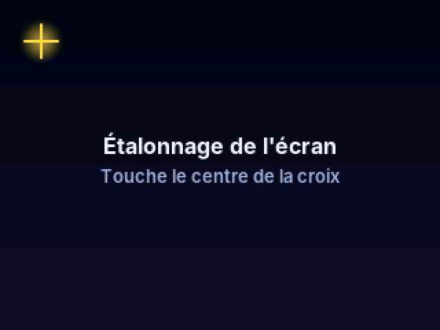 | 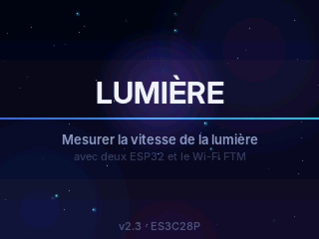 | 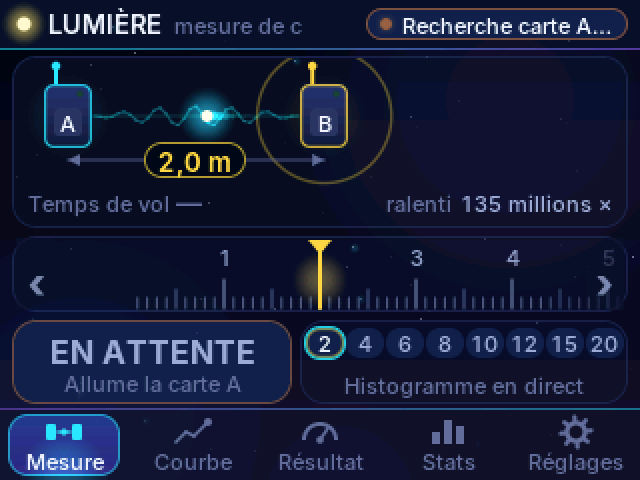 | 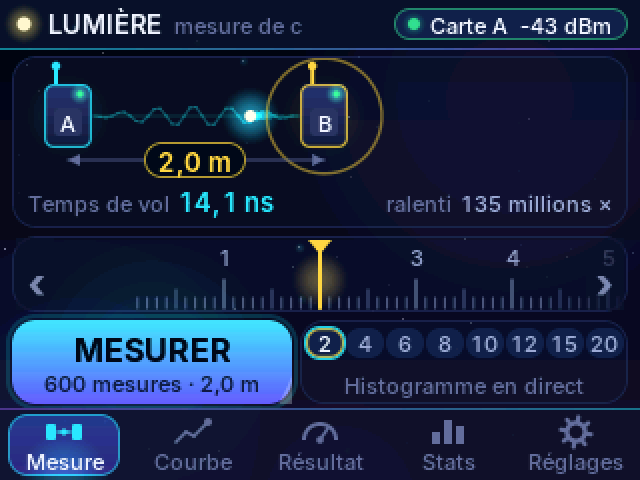 |

L'étalonnage tactile en 3 croix n'est demandé que si aucun étalonnage n'est enregistré. Si tu utilises la carte pour d'autres programmes, il est partagé avec eux (espace NVS `touchcal`).

### 5.2 Onglet **Mesure**

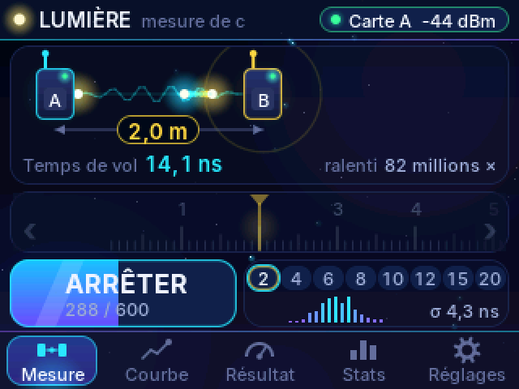

| Zone | Ce qu'on y voit | Ce qu'on y fait |
|---|---|---|
| **Scène** | Les cartes A et B, l'onde Wi-Fi, le photon aller (jaune) et retour (cyan), la distance, le temps de vol en direct, et le « ralenti » de l'animation (ex. *135 millions ×*) | — |
| **Règle** | Graduée au 1/10 de mètre, avec un repère jaune au centre | Glisser au doigt (avec inertie). Les flèches **‹ ›** ajustent de ± 0,1 m |
| **MESURER** | Nombre de mesures et distance | Lance la série. Pendant la mesure, le bouton devient une barre de progression **ARRÊTER** |
| **Pastilles** | Distances du plan : 🟢 déjà mesurée, contour jaune clignotant = la suivante conseillée | Un appui règle directement cette distance |
| **Histogramme** | Distribution des temps de vol en direct, avec l'écart-type σ | — |

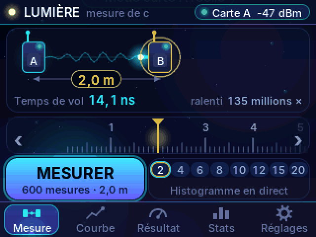

### 5.3 Onglet **Courbe**

| Droite ajustée | Détail d'un point |
|---|---|
| 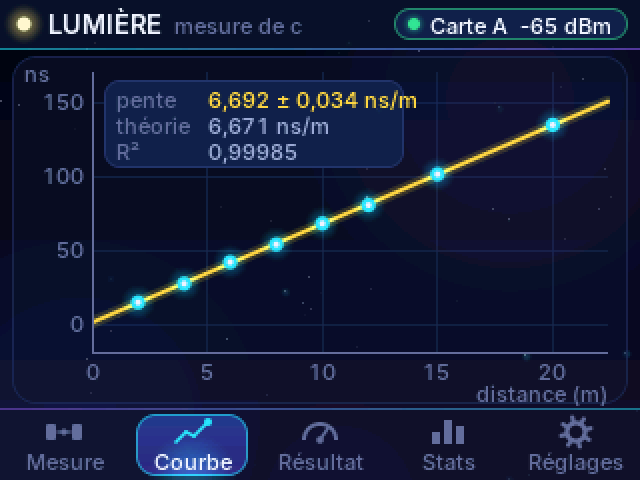 | 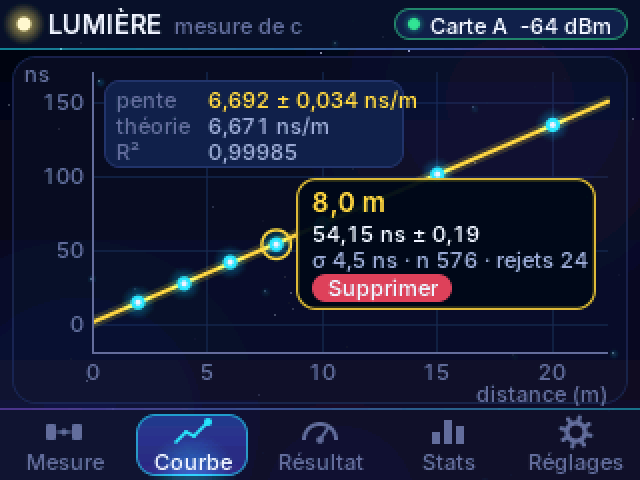 |

On y trouve :
- les points avec leurs barres d'erreur, la droite ajustée (tracée en animation) et sa bande de confiance ;
- la droite théorique en pointillés ;
- la pente ± son incertitude, la pente théorique et R².

**Touche un point** pour voir sa moyenne, son écart-type, le nombre de mesures gardées et rejetées, avec un bouton **Supprimer**.

### 5.4 Onglet **Résultat**

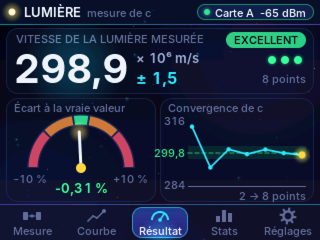

On y trouve :
- **c** en grand, avec son incertitude (dès 3 points) ;
- une note : *Excellent* (< 1 %), *Bon* (< 5 %), *Moyen* (< 15 %) ou *À améliorer* ;
- une **jauge d'écart** à la vraie valeur (de −10 % à +10 %), dont l'aiguille oscille avant de se stabiliser ;
- la **convergence** de c au fil des points.

Dès 2 points, une animation plein écran dévoile chaque nouvelle valeur de c :

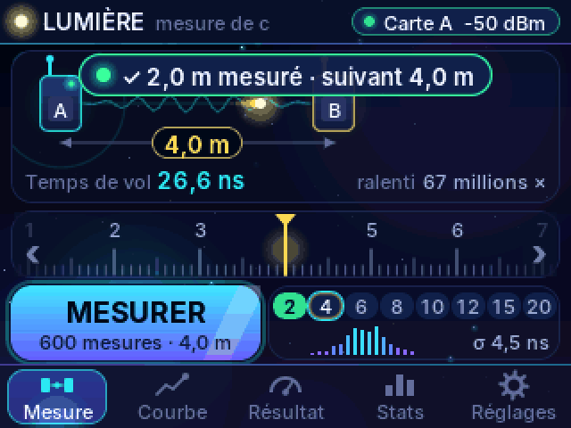

### 5.5 Onglet **Stats**

| Après une mesure | Pendant une mesure |
|---|---|
| 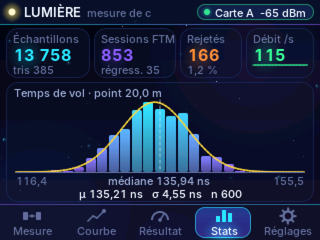 | 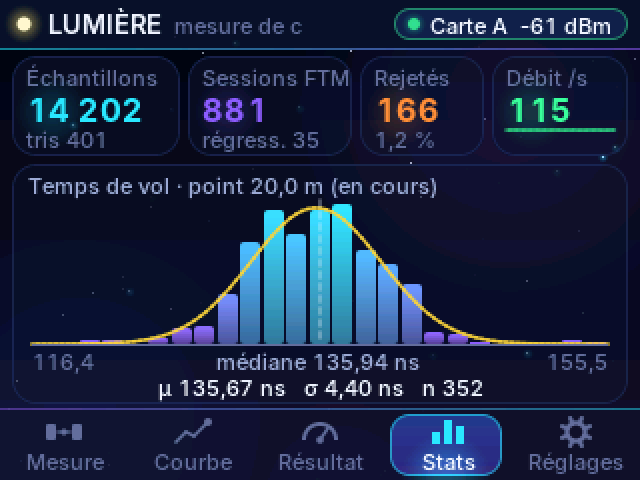 |

- **Échantillons** : temps de vol reçus, et nombre de **tris** calculés
- **Sessions FTM** : séries de 16 échanges, et nombre de **régressions** calculées
- **Rejetés** : aberrations écartées par le filtre (souvent des échos), en nombre et en %
- **Débit** : échantillons par seconde, avec une petite courbe
- **Histogramme** du dernier point : colonnes alignées sur les paliers de 1,5625 ns, courbe de Gauss, médiane, moyenne μ, écart-type σ et nombre n

### 5.6 Onglet **Réglages**

| Réglages | Plan « Libre » | Luminosité | Mode simulation | Effacement |
|---|---|---|---|---|
| 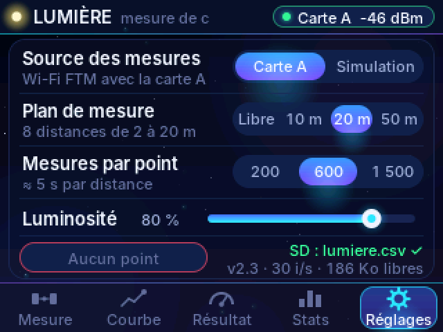 | 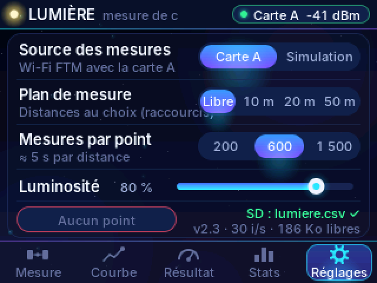 | 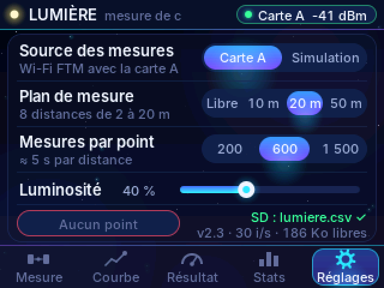 | 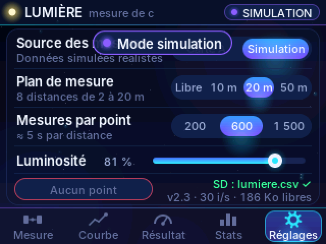 | 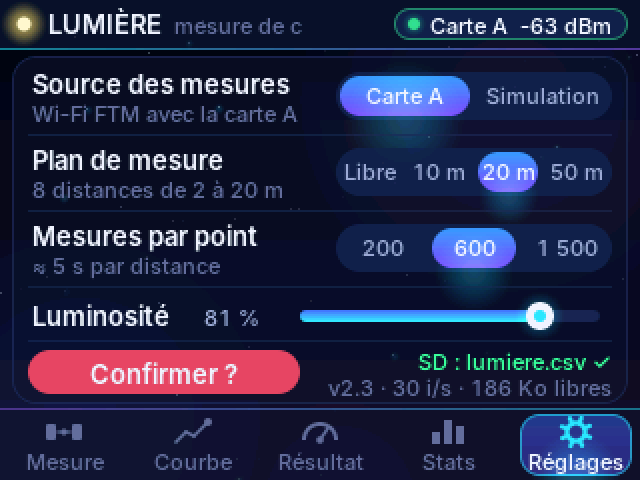 |

| Réglage | Choix | Effet |
|---|---|---|
| **Source des mesures** | Carte A / Simulation | La simulation imite de vraies mesures FTM, pour s'entraîner sans carte A |
| **Plan de mesure** | Libre · 10 m · 20 m · 50 m | Libre : raccourcis 1, 2, 5, 10, 20, 30, 50 m · **10 m** : 2→10 m · **20 m** : 2→20 m · **50 m** : 5→50 m (8 distances) |
| **Mesures par point** | 200 · 600 · 1 500 | Plus il y en a, plus le point est précis (≈ 2, 5 ou 13 s par distance) |
| **Luminosité** | 5 → 100 % | Curseur glissant |
| **Effacer les points** | 2 appuis | Le 2ᵉ appui (« Confirmer ? ») doit venir dans les 3 s |
| Pied de page | — | État de la SD, version, images/s, mémoire libre |

Les réglages et les points sont **mémorisés** : ils survivent à un redémarrage.

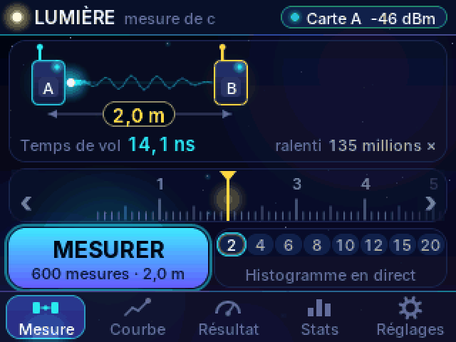

### 5.7 Messages

| Message | Signification |
|---|---|
| ✓ *2,0 m mesuré · suivant 4,0 m* | Point ajouté. La règle passe à la distance suivante du plan |
| *Trop près : 17 % des mesures à 0, recule (> 2 m)* | À très courte distance, la puce bloque une partie des mesures à 0, ce qui fausse le point |
| *Mesure invalide (pas assez de données)* | Moins de 20 mesures utilisables |
| *Carte A introuvable* | Le répondeur n'est pas allumé ou est hors de portée |
| ✓ *Plan terminé ! Va voir Résultat* | Toutes les distances du plan sont mesurées |

---

## 6. Ce qui se passe pendant une mesure

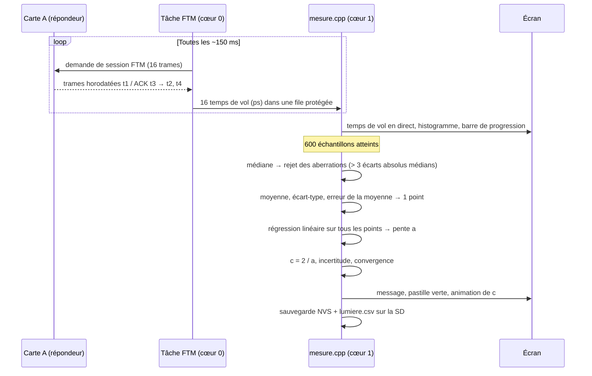

| Étape | Animation |
|---|---|
| La série se remplit : 600 mesures en ≈ 5 s, histogramme en direct |  |
| Le plan complet, de 2 à 20 m (accéléré ×4) | 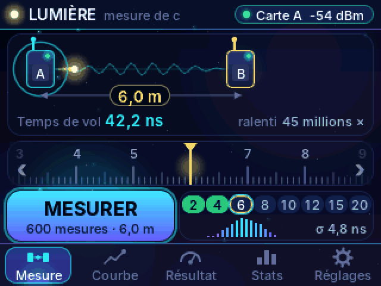 |
| Une mesure suivie depuis l'onglet Stats | 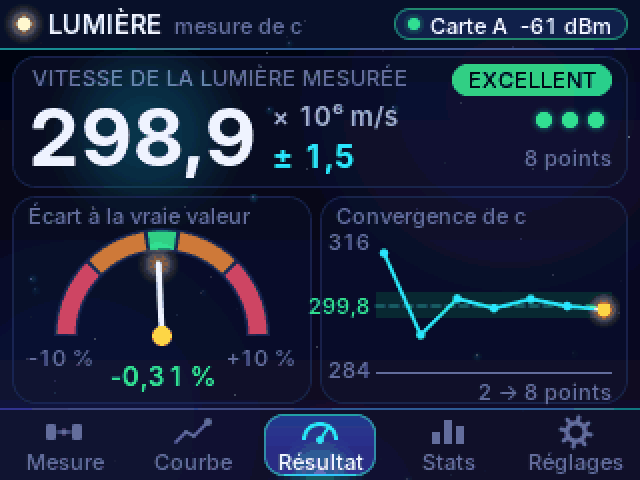 |
| Piège : trop près (0,5 m), puis suppression du point | 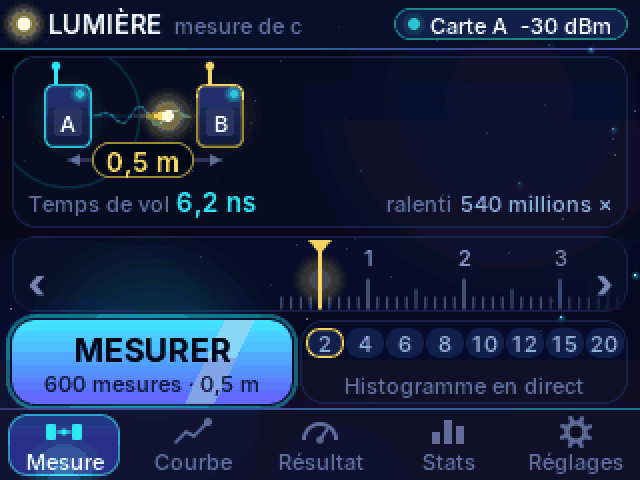 |

---

## 7. Mode opératoire

Le protocole complet, avec fiche de relevés et questions, est dans [`protocole_etudiants.md`](protocole_etudiants.md). En résumé :

1. **Dehors**, ou dans un long couloir, sans personne entre les cartes.
2. Les deux cartes à environ **1 m du sol**, antennes face à face, toujours dans la même orientation.
3. La **carte A** reste fixe, sur batterie. On déplace la **carte B**.
4. On mesure au mètre ruban la distance **d'antenne à antenne**.
5. On règle cette distance sur la règle, puis on appuie sur **MESURER**. On ne bouge pas pendant environ 5 s.
6. On recommence pour chaque distance du plan **« 20 m »** (2, 4, 6, 8, 10, 12, 15 et 20 m).
7. On lit **c** dans l'onglet *Résultat*.

**À éviter :**
- distance de moins de 2 m ;
- murs ou plafond proches (les échos faussent la mesure) ;
- personnes entre les cartes ;
- bouger pendant une série.

---

## 8. Exploiter les données sur PC

Chaque échantillon brut est ajouté à `/lumiere.csv` sur la carte microSD :

```
distance_m,rtt_ps,rssi,source
2.00,14063,-41,reel
2.00,12501,-41,reel
...
```

```bash
pip install matplotlib
python outils/mesure.py analyser lumiere.csv --graphe
```

Le script refait tout le calcul indépendamment de la carte (médianes, droite, c) et trace le graphique. Les étudiants peuvent aussi ouvrir le fichier dans un tableur et faire la régression eux-mêmes.

---

## 9. Simulateur PC et vidéo

Toutes les captures et animations de ce dépôt sont produites par le **simulateur PC**. Il compile **le même code d'interface et de calcul** que la carte (`interface.cpp`, `mesure.cpp`, `gfx.cpp`) et enregistre les images, avec des mesures FTM simulées réalistes : paliers de 1,5625 ns, bruit, valeurs bloquées à 0, aberrations.

```bash
cd outils/simulateur
g++ -std=c++17 -O2 -I../../firmware/lumiere_console sim_tuto.cpp \
    ../../firmware/lumiere_console/{gfx,mesure,interface,polices}.cpp -o sim_tuto
mkdir -p images && ./sim_tuto images

pip install pycairo numpy scipy piper-tts        # et ffmpeg
# voix française : fr_FR-siwis-medium.onnx (+ .onnx.json), par exemple depuis
# https://github.com/k2-fsa/sherpa-onnx/releases/download/tts-models/vits-piper-fr_FR-siwis-medium.tar.bz2
python3 ../video/narration.py fr_FR-siwis-medium.onnx voix
python3 ../video/faire_video.py images video --voix voix              # rendu des 12 scènes
python3 ../video/faire_video.py images video --voix voix --assembler
python3 ../video/faire_video.py images video --voix voix --final      # voix + musique + sous-titres
```

---

## 10. Dépannage

| Symptôme | Cause probable | Solution |
|---|---|---|
| Badge orange « Recherche carte A… » | Carte A éteinte, hors de portée, ou nom de réseau différent | Vérifier le moniteur série de la carte A, et `SSID_LUMIERE` dans les deux croquis |
| `Session FTM : pas de reponse de la carte A` | Carte A sans FTM fonctionnel (ESP32-C6 v0.1, ESP32 classique) | Utiliser un ESP32-S3 comme carte A |
| Écran noir | Rétroéclairage (GPIO 45) ou `User_Setup.h` de TFT_eSPI | Reprendre la configuration TFT_eSPI de la carte |
| Animation saccadée | `SPI_FREQUENCY` trop bas | 40 MHz ou plus dans `User_Setup.h` (le nombre d'images/s s'affiche dans Réglages) |
| *Trop près…* | Distance < 2 m | Reculer |
| c très faux (> 20 %) | Échos (intérieur), quelqu'un entre les cartes, distances mal mesurées | Aller dehors, mesurer d'antenne à antenne, utiliser des distances plus longues |
| Tactile décalé | Étalonnage | Effacer la clé NVS `touchcal` (ou réétalonner depuis un autre programme) |

---

## 11. Licence et crédits

- Code : licence MIT (voir `LICENSE`)
- Police **Inter**, de Rasmus Andersson, sous licence SIL Open Font License 1.1
- FTM : norme IEEE 802.11mc, prise en charge Espressif ESP-IDF / Arduino-ESP32
- Voix de synthèse : Piper, modèle fr_FR-siwis-medium (jeu de données SIWIS, licence CC-BY 4.0)
- Captures et vidéo générées par le simulateur fourni (données simulées, calées sur de vraies mesures FTM entre deux ESP32-S3)
